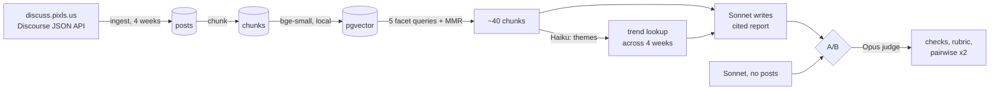

# Community Voices

A weekly report on what [discuss.pixls.us](https://discuss.pixls.us), an open-source photography forum,
talked about and what it will likely talk about next. The report is written with RAG over four weeks of
the forum's posts. Each A/B run also asks the same model to write the report with no retrieval, and an
LLM judge scores the two side by side.

Built as a take-home for Transcendent Endeavors. The design is in [`docs/DESIGN.md`](docs/DESIGN.md).

## Run it

You need Docker. No API key is needed to look around.

```sh
git clone <this repo> community-voices
cd community-voices
docker compose up --build
```

Open <http://localhost:3000>.

- On first boot the database starts empty, so the app loads the committed seed (3,402 chunks from
  four weeks of posts) and embeds it locally. That takes about 160 s in Docker on an M-series Mac. The
  page works meanwhile: Report and A/B show the sample run right away, and the Map tab shows
  "computing" until embedding and the 2D projection finish, then draws itself.
- Without a key you see one real A/B run committed in `seed/`, labeled "Sample run" everywhere it
  appears. "Generate report" and "Run new A/B" answer that no key is set. Nothing is charged.
- To run live reports, copy `.env.example` to `.env` and set `ANTHROPIC_API_KEY`. It's the only
  variable you need; the others have defaults and are listed in `.env.example`. Then run
  `docker compose up` again. A report costs about $0.03 to $0.08 and an A/B run about $0.29 (see [Cost](#cost)).

Data lives in the `db-data` volume. `docker compose down -v` resets it, and the next boot loads the seed
again.

## What you'll see

| Tab        | What it shows                                                                                                                                                                                                                                                                                    |
| ---------- | ------------------------------------------------------------------------------------------------------------------------------------------------------------------------------------------------------------------------------------------------------------------------------------------------ |
| **Report** | The RAG report for the selected week: themes, notable threads, mood and predictions. Every claim cites forum posts, and each citation links to the post.                                                                                                                                         |
| **A/B**    | The RAG and no-RAG documents side by side, with citation checks, rubric scores, the judge's pairwise verdicts and the cost of each call.                                                                                                                                                         |
| **Map**    | One dot per chunk, laid out with UMAP and colored by week. The selected report's source posts are ringed, sized by how many retrieval runs picked them. Nearby dots are similar posts. The distance between groups and the axes mean nothing. Hover for the post, click to open it on the forum. |
| **Stats**  | The most-retrieved posts across retrieval runs, and the recorded cost of every run with a total.                                                                                                                                                                                                 |

On a fresh install, Stats lists only the sample run's cost and says no retrievals are logged yet: the
sample run has no retrieval rows, so its rings on the map are all the smallest size. Generating a
report fills both.

## How it works



1. **Ingest.** A generic Discourse client pages `/latest.json` and each active topic, politely (robots.txt,
   600 ms between requests, request and token caps). Re-runs are idempotent. The four weeks are
   committed in `seed/`, so a fresh install needs no network.
2. **Chunk and embed.** One post is one chunk, with its topic title and category in front. Long posts are
   split. Quoted text is stripped, and replies under about 15 words are dropped. `bge-small-en-v1.5`
   runs locally through transformers.js (384 dimensions), so embeddings need no second API key. The
   weights are baked into the image.
3. **Retrieve.** Five facet queries (releases, help and bugs, photo edits, events, frustrations) each take
   the 15 nearest chunks from the target week. MMR keeps 8 of each, so one big thread can't crowd out the
   rest. Every retrieval is logged for the Stats tab.
4. **Generate.** Claude Haiku 5.5 names 4 to 6 themes from the chunks. Each theme is counted across the
   target week and the three before it, as a trend hint for predictions. Claude Sonnet 5.5 writes the
   report as structured JSON, citing `[post N]` ids. Citations are checked against the context, with one
   repair call if they fail.
5. **Compare.** An A/B run writes a fresh RAG report, then a no-RAG document from the forum's name and
   dates only. Claude Opus 5.5 judges both: a 1 to 5 rubric for each document on its own, and a blind
   pairwise comparison asked twice with the order swapped.

Stack: pnpm workspace, Hono API, Vite + React + Tailwind web app, Postgres 18 with pgvector through
Drizzle, and zod contracts shared by both sides. More in [`docs/DESIGN.md`](docs/DESIGN.md).

## A/B findings

From the committed sample run (`3f44d043`, week of 2026-10-26, run on 2026-11-08). It took 36 s and cost
$0.29.

|                         | RAG  | No RAG |
| ----------------------- | ---- | ------ |
| Claims                  | 14   | 2      |
| Citations               | 55   | 0      |
| Citation problems       | 0    | n/a    |
| Grounding               | 4    | 3      |
| Specificity             | 4    | 1      |
| Coverage                | 4    | 1      |
| Prediction plausibility | 4    | 2      |
| Readability             | 5    | 3      |
| Pairwise (both orders)  | wins |        |

Without posts, Sonnet 5.5 declines to invent. It answers "Insufficient evidence" for the week and
offers one low-confidence prediction about the forum's usual mix of darktable and RawTherapee threads.
Most of the gap in the scores comes from that refusal. The RAG report names specific releases, bugs
and threads, and every citation points to a post that was in its context.

Caveats:

- The judge reads the posts the RAG writer read, so it can catch invented facts. Those posts are RAG's
  own context, which tilts grounding toward RAG by construction
  ([assumption #31](docs/ASSUMPTIONS.md)).
- Opus judges Sonnet, a model from its own family, which keeps one key but risks self-preference
  ([#7](docs/ASSUMPTIONS.md)). Blinding, order swapping and the deterministic checks reduce it.
- The scores come from one run (n = 1), which is too few to measure a difference.
- "No RAG" means no forum data at all ([#2](docs/ASSUMPTIONS.md)). A fairer rival would get the whole week
  pasted in (variant C, not built).

## Cost

| Run     | Typical cost   | Cap (env var)                 |
| ------- | -------------- | ----------------------------- |
| Report  | $0.03 to $0.08 | $0.50 (`MAX_RUN_COST_USD`)    |
| A/B run | about $0.29    | $1.50 (`MAX_AB_RUN_COST_USD`) |

Before each call, a run adds its spend so far to the call's worst case and stops if that would pass the
cap. The four judge calls share a ~16k-token prompt prefix, which is prompt-cached: rubric and pairwise
each write the cache once and read it once. Building the whole project spent about $0.63 in recorded
runs, which the Stats tab shows.

## Develop

Needs Node 24 and pnpm 9.

```sh
pnpm install
docker compose up -d db      # Postgres + pgvector on :5433
pnpm dev                     # API on :3000 (tsx watch), web on :5173 (Vite, proxies /api)
```

Open <http://localhost:5173>. The API reads `.env` from the repo root if present.

| Command                                    | What it does                                                                                            |
| ------------------------------------------ | ------------------------------------------------------------------------------------------------------- |
| `pnpm test`                                | Unit tests (also run by the pre-commit hook)                                                            |
| `pnpm db:test:up && pnpm test:integration` | Integration tests against a throwaway pgvector on :5434                                                 |
| `pnpm test:model`                          | Real-model tests: the local embedder, plus one tiny Haiku call (under $0.001) that runs only with a key |
| `pnpm typecheck`, `pnpm lint`              | Type check and lint                                                                                     |
| `pnpm ingest`                              | Fetch four weeks from pixls into the dev DB (about 8 minutes, polite pace)                              |
| `pnpm run search "<query>"`                | Vector search in one week (`pnpm search` is a pnpm built-in, hence `run`)                               |
| `pnpm retrieve --week 2026-10-26`          | Print the facet retrieval for a week, and log it                                                        |
| `pnpm seed:export`                         | Write the DB's posts to `seed/`                                                                         |
| `pnpm ab:export-sample <id>`               | Write an A/B run to `seed/ab-run-sample.json`                                                           |

CI (`.github/workflows/ci.yml`) runs format check, lint, typecheck, unit and integration tests, the web
build and the Docker build.

## Limits and what's next

- Not built (below the plan's cut line): variant C with the whole week in context, Markdown export,
  a weekly ingestion schedule, and a second forum as a config-only demo.
- Jobs run in-process, with status in Postgres and no queue, so a restart drops a running job
  ([#8](docs/ASSUMPTIONS.md)).
- There is no auth. It's a local single-user demo ([#9](docs/ASSUMPTIONS.md)).
- The embedder is English only, so the app is too ([#10](docs/ASSUMPTIONS.md)).

## How it was built

Built with Claude Code over about 9 hours, test-first, phase by phase.

- [`docs/PLAN.md`](docs/PLAN.md): phases, estimates and status.
- [`docs/DESIGN.md`](docs/DESIGN.md): the agreed design, with the measurements behind each choice.
- [`docs/ASSUMPTIONS.md`](docs/ASSUMPTIONS.md): every call made where the brief was ambiguous, and when
  to revisit it.
- [`docs/WORKFLOW.md`](docs/WORKFLOW.md): how the AI was used, every place it was wrong and got
  corrected, and the time log.
- [`docs/research/`](docs/research/): source research on the forum's API and the stack.

## License

Code: [MIT](LICENSE).

`seed/` has its own license. The forum posts, and the sample run that quotes them, are by the pixls.us
community under [CC BY-NC-SA 4.0](https://creativecommons.org/licenses/by-nc-sa/4.0/). Each post keeps
its author and a link back. See [`seed/README.md`](seed/README.md).
